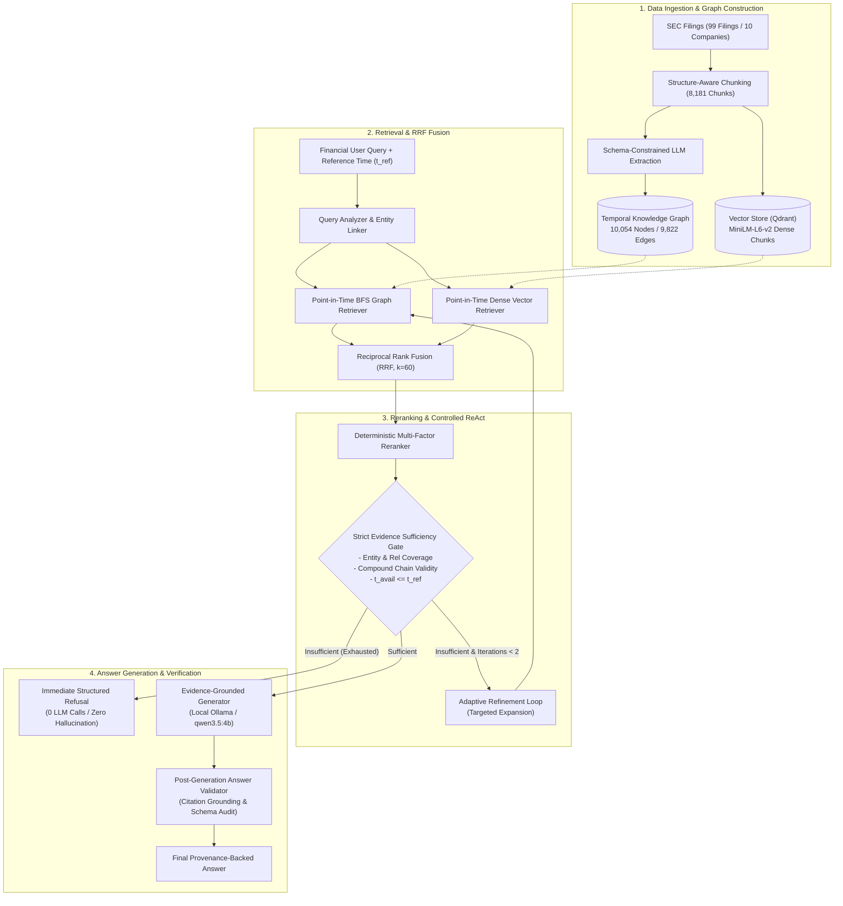

# FinGraph AI

> **A Temporal Knowledge Graph and Hybrid GraphRAG Framework for Multi-Hop Financial Question Answering**

[]()
[]()
[]()
[]()

FinGraph AI is a research prototype that investigates whether combining a **Temporal Knowledge Graph (TKG)** with dense vector retrieval and structured relational retrieval can improve multi-hop question answering over regulatory SEC filings while enforcing strict point-in-time evidence constraints and eliminating temporal leakage.

---

## Table of Contents

- [Research Problem \& Motivation](#research-problem--motivation)
- [Core Contributions](#core-contributions)
- [System Architecture](#system-architecture)
- [Technology Stack](#technology-stack)
- [Repository Structure](#repository-structure)
- [Quick Start](#quick-start)
  - [Prerequisites](#prerequisites)
  - [Installation](#installation)
  - [Running FinGraph AI](#running-fingraph-ai)
  - [Running the B1 Baseline](#running-the-b1-baseline)
  - [Running the Evaluation Benchmark](#running-the-evaluation-benchmark)
  - [Running the Sufficiency Ablation](#running-the-sufficiency-ablation)
- [Benchmark \& Evaluation Results](#benchmark--evaluation-results)
  - [Baseline Comparison (64-Question Benchmark)](#baseline-comparison-64-question-benchmark)
  - [Evidence Sufficiency Ablation (CFG0–CFG5)](#evidence-sufficiency-ablation-cfg0cfg5)
  - [Temporal Safety \& Parametric Leakage](#temporal-safety--parametric-leakage)
- [Limitations \& Known Constraints](#limitations--known-constraints)
- [Documentation Map](#documentation-map)
- [Citation](#citation)

---

## Research Problem & Motivation

Standard Retrieval-Augmented Generation (RAG) frameworks suffer from three fundamental vulnerabilities when applied to complex financial intelligence:

1. **Temporal Information Leakage:** Financial disclosures are published chronologically. Standard RAG indexes chunks without point-in-time availability boundaries, allowing future events (e.g., an earnings announcement or supply shock from 2025) to contaminate decisions as of an earlier historical reference date ($t_{\text{ref}}$).
2. **Multi-Hop Relational Disconnection:** Financial risk and supply-chain queries frequently require multi-hop reasoning (e.g., *"What manufacturing risks affect suppliers that supply Apple?"*). Vector similarity searches often retrieve isolated passages containing individual keywords (`Apple`, `supplies`, `risk`) without verifying that an unbroken, directionally valid relational chain connects the specific supplier to Apple and to the identified risk.
3. **Parametric Hallucination on Unanswerable Queries:** Large language models routinely hallucinate plausible-sounding financial metrics or leverage pre-training memory to answer historical questions where the retrieved corpus lacks sufficient grounding.

FinGraph AI addresses these challenges through a unified framework integrating **structure-aware SEC chunking**, a **Temporal Knowledge Graph (TKG)**, **hybrid Reciprocal Rank Fusion (RRF)**, **deterministic reranking**, an **adaptive ReAct retrieval loop**, a **strict point-in-time evidence sufficiency gate**, and **grounded refusal policies**.

---

## Core Contributions

- **Structure-Aware SEC Processing:** Ingestion and parsing across 99 SEC filings (10-K, 10-Q) covering 10 companies, yielding 8,181 chunks with strict temporal metadata (`available_time`, `publication_date`, `fiscal_period`, `chunk_id`).
- **Unified Temporal Knowledge Graph:** A multi-company semantic knowledge graph comprising 10,054 nodes and 9,822 directed edges with temporal timestamps, canonical entity resolution (`company:{TICKER}`), and typed financial predicates (`SUPPLIES`, `AFFECTED_BY`, `HAS_RISK`, `COMPETES_WITH`).
- **Hybrid GraphRAG Retrieval:** Combining dense cosine vector retrieval (`all-MiniLM-L6-v2` in Qdrant) and point-in-time breadth-first graph traversal (BFS) via Reciprocal Rank Fusion ($k=60$).
- **Deterministic Multi-Factor Reranker:** Reranking candidate evidence using hybrid RRF rank, entity lexical overlap, relational intent match, extraction confidence, and hop penalties, coupled with a hard zero-leakage drop gate ($t_e > t_{\text{ref}} \implies -\infty$).
- **Strict Evidence Sufficiency Gate:** Pre-generation validation of entity coverage, relationship coverage, reasoning hop depth, provenance completeness, and **compound supplier-risk chain connectivity**.
- **Evidence-Grounded Refusal Policy:** Zero LLM token invocation on ungrounded or insufficient queries, returning an immediate, structured refusal that prevents hallucinations.
- **Zero Future Evidence Infiltration:** Guaranteed $\text{FEIR} = 0.00\%$ across all benchmark evaluations, dropping future infiltration from $78.46\%$ down to $0.00\%$.

---

## System Architecture



---

## Technology Stack

| Layer | Component | Technologies / Libraries |
| :--- | :--- | :--- |
| **Language & Runtime** | Core Platform | Python 3.12 (macOS Apple Silicon & Linux) |
| **LLM Backend** | Local Generation & Extraction | Ollama running `qwen3.5:4b` ($T=0$, deterministic) |
| **Vector Database** | Dense Retrieval | Qdrant (In-Memory / Local Client) |
| **Embeddings** | Dense Representation | HuggingFace `sentence-transformers/all-MiniLM-L6-v2` |
| **Knowledge Graph** | Temporal Graph & In-Memory BFS | NetworkX with custom JSON persistence |
| **Data Validation** | Schema & Provenance | Pydantic v2 & Python Standard Library Dataclasses |
| **Testing** | Verification Suite | pytest (177 tests passing) |

---

## Repository Structure

```text
FinGraph-AI/
├── benchmark/                       # 64-question verified evaluation benchmark
│   ├── questions.json               # Canonical benchmark questions and metadata
│   ├── dataset_builder.py           # Verification and audit utilities
│   └── README.md                    # Detailed benchmark audit report and schema
├── data/
│   ├── raw/sec_filings/             # Downloaded SEC filings (10-K, 10-Q)
│   └── processed/
│       ├── chunks/                  # 8,181 processed chunks across 99 filings
│       └── unified/
│           ├── fingraph_semantic_kg.json   # Unified multi-company KG (10,054 nodes)
│           └── aapl_temporal_graph.json    # Single-stock AAPL graph (1,495 nodes)
├── docs/                            # Comprehensive research documentation
│   ├── ARCHITECTURE.md              # Detailed architecture specification & diagrams
│   ├── METHODOLOGY.md               # Research methodology, hypotheses & math
│   ├── EVALUATION.md                # Phase 5 empirical benchmark & ablation audit
│   ├── knowledge_graph_schema.md    # Node and edge schema definitions
│   └── system_architecture.md       # Architectural overview
├── results/                         # Evaluation artifacts (gitignored/untracked)
│   └── phase5/
│       ├── benchmark_evaluation_summary.json  # Canonical 64-question benchmark summary
│       ├── per_question_results.csv           # Detailed per-query execution trace
│       └── sufficiency_ablation/              # CFG0–CFG5 ablation experiments
├── scripts/                         # Command-line entry points
│   ├── run_fingraph.py              # Single-query FinGraph AI execution
│   ├── run_rag_baseline.py          # Single-query B1 Vector Baseline execution
│   ├── run_evaluation.py            # 64-question comparative benchmark harness
│   └── run_sufficiency_ablation.py  # 6-configuration sufficiency ablation harness
├── src/                             # Core library source code
│   ├── config.py                    # Global system paths and model settings
│   ├── evaluation/                  # Metrics, temporal audit, and leakage harnesses
│   ├── graph/                       # TKG construction, schemas, and persistence
│   ├── ingestion/                   # SEC parsing, structure-aware chunking
│   ├── qa/                          # ReAct agent, sufficiency gate, answer generator
│   └── retrieval/                   # Vector, graph, hybrid fusion, and reranker
├── tests/                           # Complete test suite (177 tests)
├── CITATION.cff                     # Citation metadata
├── CONTRIBUTING.md                  # Development guidelines and contribution protocol
└── README.md                        # Project entry point (this file)
```

---

## Quick Start

### Prerequisites

1. **Python 3.12+** (recommended via virtual environment).
2. **Ollama** installed and running locally.
3. Pull the local generation model:
   ```bash
   ollama pull qwen3.5:4b
   ```

### Installation

Clone the repository and set up the local Python virtual environment:

```bash
git clone https://github.com/Dhruv-vm/FinGraph-AI.git
cd FinGraph-AI

python3.12 -m venv .venv
source .venv/bin/activate
pip install --upgrade pip
pip install -r requirements.txt
```

Verify that the test suite passes (177 tests):

```bash
.venv/bin/pytest tests/ -q
```

### Running FinGraph AI

Execute a multi-hop financial query through the full FinGraph AI framework:

```bash
.venv/bin/python scripts/run_fingraph.py \
  --query "What manufacturing risks affect the suppliers that supply Apple?" \
  --reference-time "2026-08-21T00:00:00+00:00" \
  --hop-depth 2
```

### Running the B1 Baseline

Execute the same query through the pure vector-only RAG baseline:

```bash
.venv/bin/python scripts/run_rag_baseline.py \
  --query "What manufacturing risks affect the suppliers that supply Apple?" \
  --top-k 5
```

### Running the Evaluation Benchmark

Run the full 64-question benchmark evaluating B1 Vector-Only RAG against FinGraph AI Full Framework:

```bash
.venv/bin/python scripts/run_evaluation.py \
  --benchmark benchmark/questions.json \
  --output-dir results/phase5
```

### Running the Sufficiency Ablation

Evaluate the 6-configuration evidence sufficiency ablation (CFG0 through CFG5):

```bash
.venv/bin/python scripts/run_sufficiency_ablation.py \
  --benchmark benchmark/questions.json \
  --output-dir results/phase5/sufficiency_ablation
```

---

## Benchmark & Evaluation Results

All empirical findings are derived from the canonical 64-question hand-verified benchmark (`benchmark/questions.json`) evaluated across the 99 SEC filing corpus.

### Baseline Comparison (64-Question Benchmark)

| Evaluation Metric | B1 Vector-Only RAG | FinGraph AI Full Framework | Absolute Delta |
| :--- | :---: | :---: | :---: |
| **Retrieval Hit@1** | 0.0625 | **0.0781** | +0.0156 (+25.0%) |
| **Retrieval Hit@5** | 0.1406 | **0.2031** | +0.0625 (+44.4%) |
| **Retrieval MRR** | 0.0847 | **0.1305** | +0.0458 (+54.1%) |
| **Retrieval NDCG@5** | 0.0375 | **0.0536** | +0.0161 (+42.9%) |
| **Document Hit@5** | 0.7344 | **0.7812** | +0.0468 (+6.4%) |
| **Cross-Document Fact Coverage** | 0.3929 | **0.5231** | +0.1302 (+33.1%) |
| **Exact Match (EM)** | 0.1406 | **0.2188** | +0.0782 (+55.6%) |
| **Token F1** | 0.3045 | **0.3309** | +0.0264 (+8.7%) |
| **Refusal Recall (Safety on Unanswerable)** | 0.6429 (9/14) | **0.9286 (13/14)** | +0.2857 (+44.4%) |
| **Refusal Precision** | **0.3913** (9/23) | 0.3171 (13/41) | -0.0742 |
| **Refusal Accuracy** | **0.7031** | 0.5469 | -0.1562 |
| **Hallucinations on Unanswerable** | 5 | **1** | **-80.0% reduction** |
| **Future Evidence Infiltration Rate (FEIR)** | 0.00% | **0.00%** | Strict temporal gate |
| **Average Retrieval Rounds** | 1.00 | 1.58 | Adaptive ReAct |

### Evidence Sufficiency Ablation (CFG0–CFG5)

Ablating the evidence sufficiency gate across 6 systematic configurations reveals the trade-off between conservative refusal safety and false refusal of answerable questions:

| Config | Entity Mode | Relationship Mode | Hop Mode | Gate Enabled | Refusal Recall | Refusal Prec | False Refusal Rate | Hallucinations |
| :---: | :---: | :---: | :---: | :---: | :---: | :---: | :---: | :---: |
| **CFG0** | Strict (100%) | Strict + Compound | Strict | Yes | **92.86%** | 31.71% | 56.00% | **1** |
| **CFG1** | Strict (100%) | Strict + Compound | Soft | Yes | 78.57% | 29.73% | 52.00% | 3 |
| **CFG2** | Partial ($\ge 50\%$) | Strict + Compound | Soft | Yes | 78.57% | **50.00%** | **22.00%** | 3 |
| **CFG3** | Strict (100%) | Textual Rel | Soft | Yes | 71.43% | 27.78% | 52.00% | 4 |
| **CFG4** | Partial ($\ge 50\%$) | Textual Rel | Soft | Yes | 50.00% | 38.89% | **22.00%** | 7 |
| **CFG5** | *Disabled* | *Disabled* | *Disabled* | No | 50.00% | 46.67% | 16.00% | 7 |

> **Key Research Finding:** CFG0 represents a high-integrity, safety-first stance, achieving $92.86\%$ refusal recall and reducing hallucinations from 7 down to 1. For production contexts tolerating modest risk in exchange for higher answering throughput, CFG2 lowers the false refusal rate from $56\%$ to $22\%$ while retaining $78.57\%$ refusal recall.

### Temporal Safety & Parametric Leakage

- **Future Evidence Infiltration Rate (FEIR):** FinGraph AI enforces a hard point-in-time cutoff on both graph edge traversal and vector retrieval. In ablation testing without temporal filtering, future evidence infiltrates the context at **$78.46\%$**, resulting in 102 temporal violations. With FinGraph AI filtering enabled, **$\text{FEIR} = 0.00\%$** (0 violations).
- **Parametric Leakage Rate (PLR):** When retrieval is disabled and the LLM is queried directly on historical questions, pre-training memory causes future event leakage at **$80.00\%$** (e.g., announcing the Blackwell B200 chip prior to its official March 2024 launch date). Grounding via FinGraph AI eliminates this leakage.

---

## Limitations & Known Constraints

1. **Conservative Refusal Bias (CFG0):** Under strict gate constraints, queries with partial entity extraction or subtle phrasing are refused even if partial textual evidence exists (56% false refusal rate on answerable queries in CFG0, addressed by CFG2).
2. **Local LLM Throughput:** Running local quantized models (`qwen3.5:4b` via Ollama) provides data privacy and reproducibility on Apple Silicon, but generation latency averages $\approx 2.5$–$4.0$ seconds per query.
3. **Point-in-Time Single-Pass Evaluation:** In the evaluation harness, when the vector index is filtered upstream for a benchmark query batch at reference date $t_{\text{ref}}$, the pre-filter candidate pool is already temporally constrained.

---

## Documentation Map

- **[System Architecture](docs/ARCHITECTURE.md):** Detailed module breakdown, data flows, reranking formulas, and Mermaid diagrams.
- **[Research Methodology](docs/METHODOLOGY.md):** Hypotheses, SEC chunking, TKG construction, compound-chain verification, and ReAct loops.
- **[Empirical Evaluation](docs/EVALUATION.md):** Comprehensive Phase 5 benchmark, ablation tables, confusion matrices, and error analysis.
- **[Knowledge Graph Schema](docs/knowledge_graph_schema.md):** Formal node, edge, and retrieval evidence schemas.
- **[Benchmark Dataset](benchmark/README.md):** Question distribution, verification log, and refusal rationale.
- **[Contributing Guidelines](CONTRIBUTING.md):** Environment setup, coding conventions, test execution, and PR checklist.
- **[Citation](CITATION.cff):** Formal BibTeX and CFF citation metadata.

---

## Citation

If you use FinGraph AI in your research or reference its temporal GraphRAG methodology, please cite:

```bibtex
@software{fingraph_ai_2026,
  author       = {Dhruv, V.},
  title        = {FinGraph AI: A Temporal Knowledge Graph and Hybrid GraphRAG Framework for Multi-Hop Financial Question Answering},
  year         = {2026},
  publisher    = {GitHub},
  journal      = {GitHub repository},
  howpublished = {\url{https://github.com/Dhruv-vm/FinGraph-AI}},
  version      = {0.1.0}
}
```
