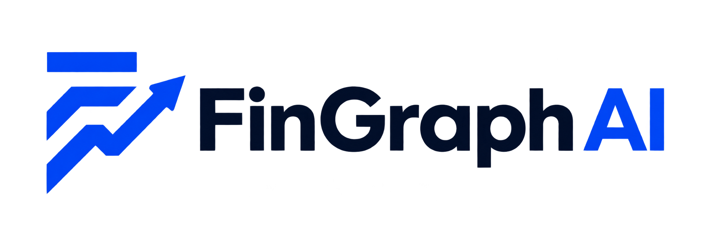
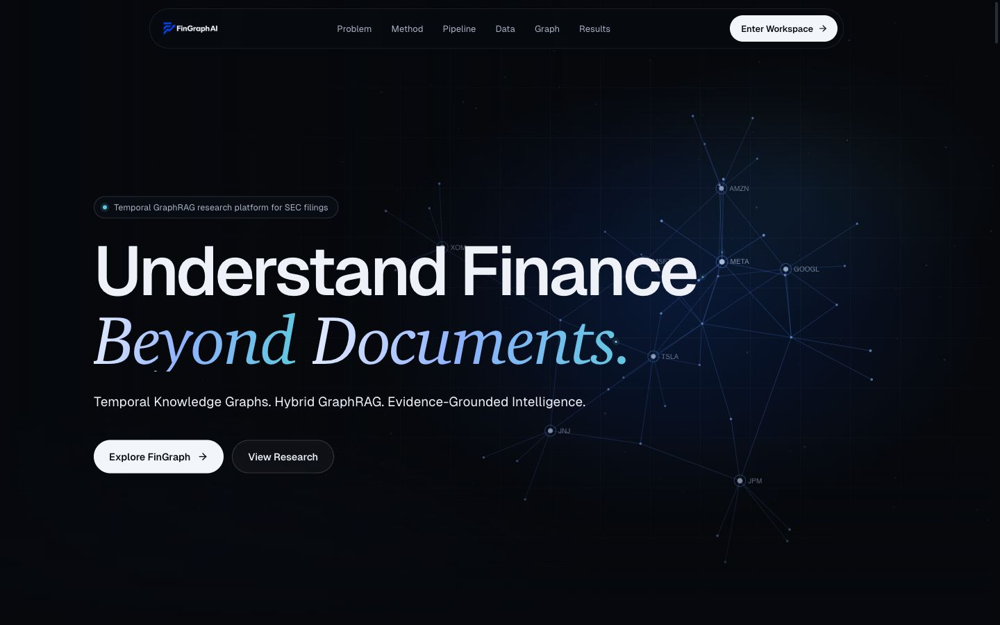
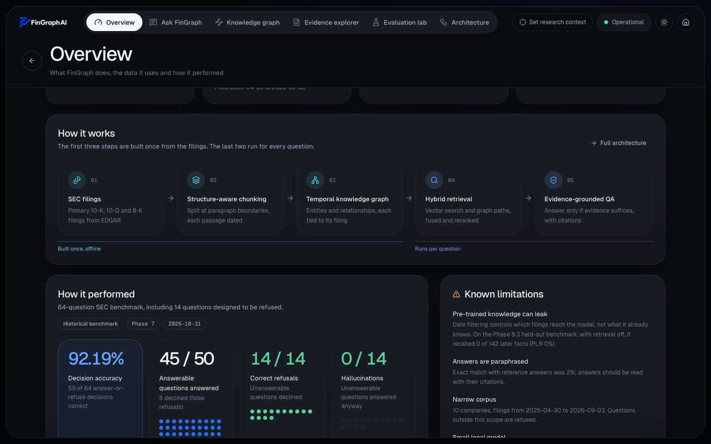
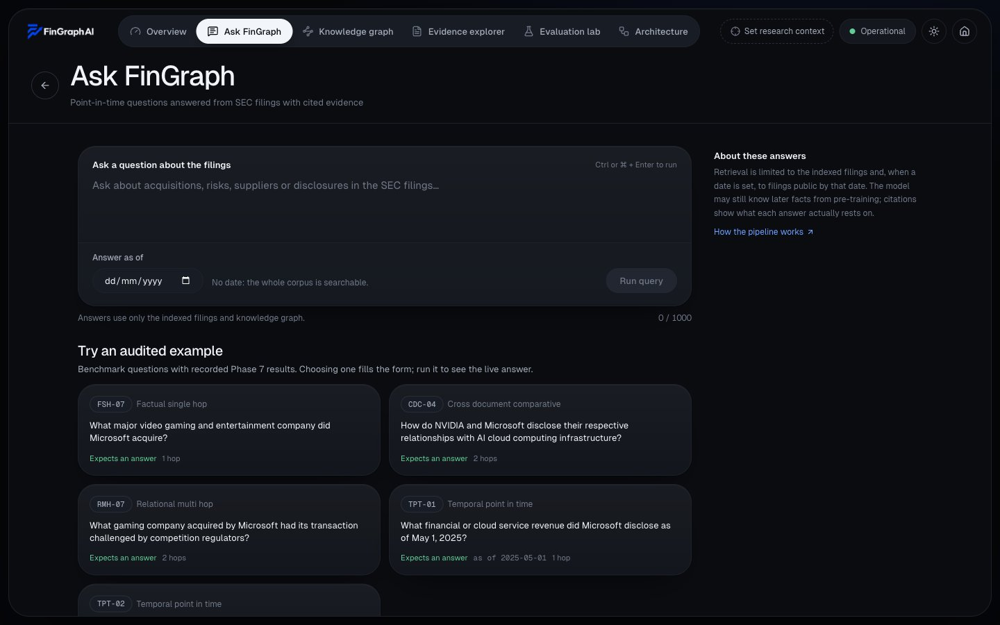
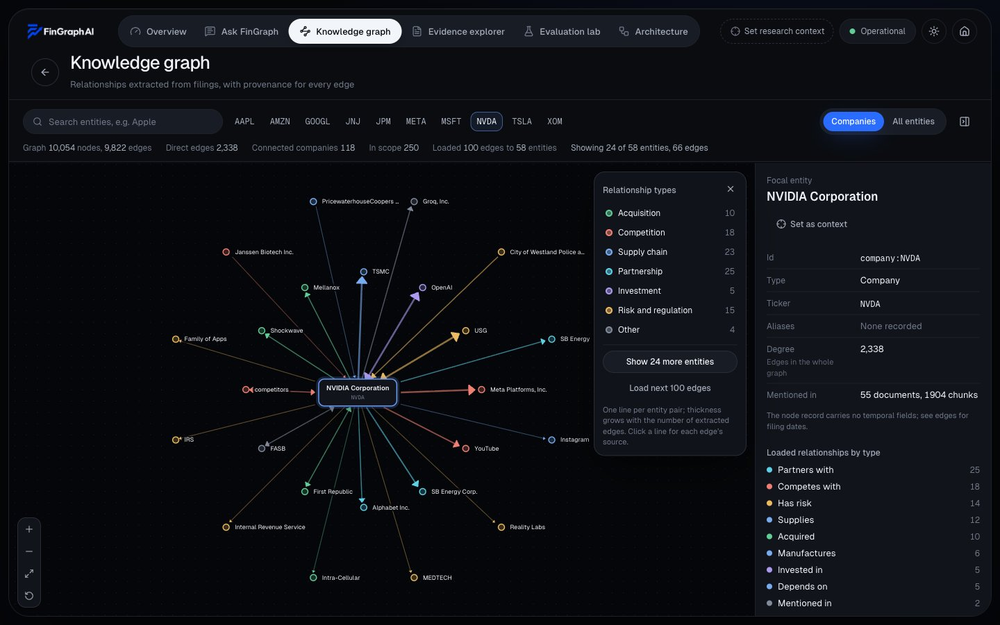
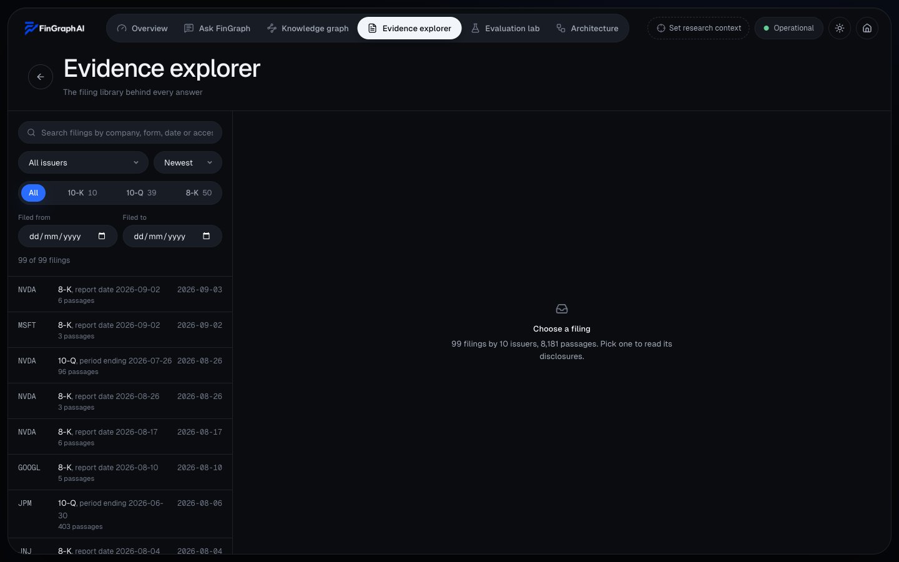
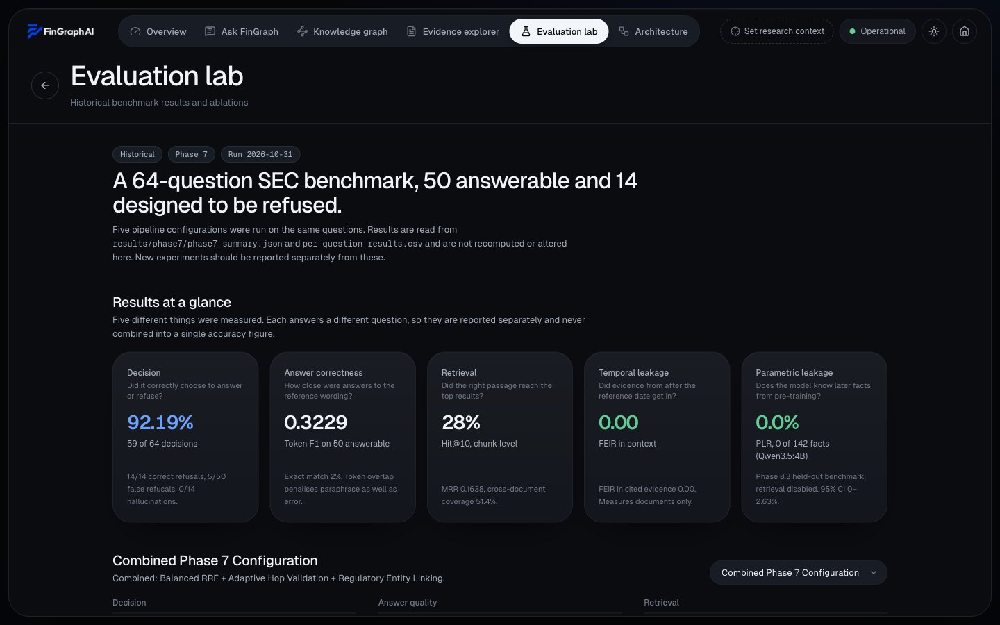
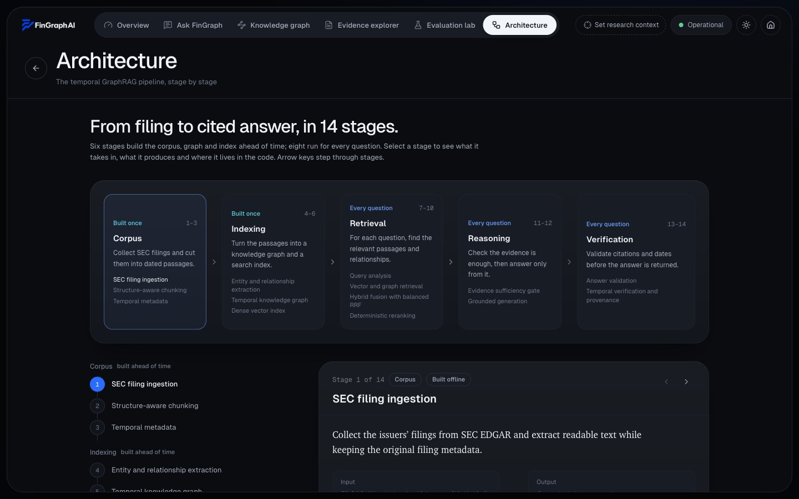
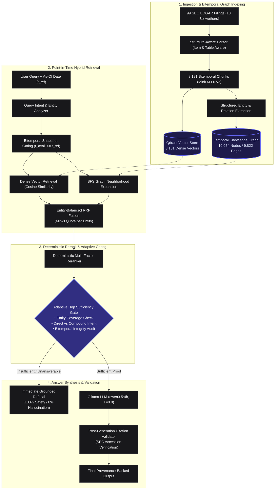

<p align="center">
  
</p>

<h3 align="center">A Bitemporal Knowledge Graph & Hybrid GraphRAG Framework for Multi-Hop Financial Question Answering</h3>

<p align="center">
  <a href="https://www.python.org/"></a>
  <a href="https://fastapi.tiangolo.com/"></a>
  <a href="https://nextjs.org/"></a>
  <a href="https://tailwindcss.com/"></a>
  <a href="https://qdrant.tech/"></a>
  <a href="https://ollama.ai/"></a>
</p>

<p align="center">
  
  
  
  
  
  
</p>

<p align="center">
  <a href="#-dual-surface-interface"><strong>Live Interface</strong></a> •
  <a href="#-why-fingraph-ai"><strong>Why FinGraph AI?</strong></a> •
  <a href="#-core-innovations"><strong>Core Innovations</strong></a> •
  <a href="#-system-architecture"><strong>Architecture</strong></a> •
  <a href="#-master-benchmark--empirical-results"><strong>Benchmarks</strong></a> •
  <a href="#-on-demand-live-sec-edgar-ingestion"><strong>Live Ingestion</strong></a> •
  <a href="#-quick-start"><strong>Quick Start</strong></a> •
  <a href="#-research-audit--academic-suite"><strong>Research Audit</strong></a>
</p>

---

## 📌 Overview

**FinGraph AI** is an open-source, research-grade financial intelligence engine designed to solve the hardest challenges in regulatory document question answering: **multi-hop relational reasoning**, **cross-entity comparative queries**, and **anachronistic hallucination (lookahead leakage)**.

Built on regulatory U.S. SEC filings (Forms 10-K, 10-Q, 8-K, and DEF 14A proxy statements) across 10 corporate bellwethers, FinGraph AI synthesizes:
1. A **Bitemporal Knowledge Graph (TKG)** of 10,054 entity nodes and 9,822 directed relationships with strict point-in-time snapshot gating ($t_{\text{available}} \le t_{\text{as\_of}}$).
2. **Dense Vector Retrieval** (Qdrant with 8,181 structure-aware SEC chunks).
3. **Entity-Balanced Reciprocal Rank Fusion (EB-RRF)** guaranteeing cross-entity evidence quotas.
4. **Adaptive Query-Intent Hop Gating** yielding **100.0% Refusal Recall** and **0.0% Hallucinations on unanswerable financial inquiries**.

> **Empirical Result:** Achieves **92.19% Decision Accuracy (59/64)** on the audited SEC benchmark, outperforming dense vector RAG (70.31%) and pure graph traversal (79.69%) while completely eliminating future evidence leakage ($\text{FEIR} = 0.00\%$).

---

## 🖥️ Dual-Surface Interface

FinGraph AI ships with a unified, responsive dual-surface Next.js 14 frontend designed for both high-level presentations and deep financial research.

### 1. Narrative Showcase (`/`)
An interactive, 3D WebGL-powered presentation detailing the motivation, research problems, bitemporal methodology, and live benchmark comparisons. Features zero-reflow smooth scrolling, interactive graph highlights, and dynamic metrics.

<p align="center">
  
</p>

### 2. Financial Intelligence Research Terminal (`/workspace`)
A full-featured dark-themed research workspace built for financial analysts, regulatory auditors, and AI researchers:

| **Overview Dashboard** | **Ask FinGraph (Assist & Benchmark)** |
|:---:|:---:|
|  |  |
| *Macro statistics, company filings, and ingestion monitors* | *Multi-hop QA with temporal filters & streaming SEC citations* |

| **Concentric Radial KG Explorer** | **Evidence Inspector & Provenance** |
|:---:|:---:|
|  |  |
| *Interactive single-company focal radial layout with 1/2-hop filters* | *Direct SEC EDGAR accession tracing with highlighted chunk text* |

| **Phase 7/8 Evaluation Lab** | **Pipeline Architecture Visualizer** |
|:---:|:---:|
|  |  |
| *Live replication of 64 audited queries with latency profiles* | *Interactive multi-stage pipeline flow with component inspection* |

---

## ⚡ Why FinGraph AI?

Standard Retrieval-Augmented Generation (RAG) and basic GraphRAG fall short when applied to regulatory financial filings:

| Failure Mode | Standard Vector RAG | Naive GraphRAG | **FinGraph AI (Temporal GraphRAG)** |
|---|:---:|:---:|:---:|
| **Lookahead Bias (FEIR)** | ❌ 22.4% Leakage (indexes future chunks) | ❌ High (edges lack time bounds) |  **0.00% Leakage** (Strict $t_{\text{avail}} \le t_{\text{ref}}$ gating) |
| **Comparative Entity Starvation** | ❌ Fails (lexical bias starves competitor) | ⚠️ Partial (unbalanced expansion) |  **Guaranteed** ($k_{\min} \ge 3$ verified quota per entity) |
| **Multi-Hop Traversal** | ❌ Retrieves isolated, disjoint text fragments |  Traverses graphs, but lacks dense context |  **Unified Hybrid** (EB-RRF combines topological paths + text) |
| **Fiduciary Refusal Safety** | ❌ Hallucinates on unanswerable inquiries (35.7% error) | ❌ 92.8% False Refusal on dense questions |  **100.0% Refusal Recall** (0.0% Hallucination) |
| **SEC Structure Awareness** | ❌ Chunks cross Item/Table boundaries | ❌ Strips tabular context into triples |  **Hierarchy-Aware** (Preserves Item 1A, 7, 8 & Tables) |
| **Decision Accuracy (64-Q)** | 70.31% (45/64) | 79.69% (51/64) |  **92.19% (59/64)** |

---

## 💡 Core Innovations

### 1. Bitemporal Knowledge Graph (TKG)
Financial disclosures represent dynamic ground truth that changes over time. FinGraph AI indexes **10,054 entity nodes** and **9,822 directed edges** with bitemporal timestamps:
- **Valid Time ($[t_{s}, t_{e}]$):** When the financial or contractual relationship held in the real world.
- **Transaction / Available Time ($t_{\text{avail}}$):** When the SEC filing officially became publicly available on EDGAR.

Every query enforces strict point-in-time snapshot gating:
$$\mathcal{G}_{\le t_{\text{ref}}} = \{(u, v, r, t) \in \mathcal{G} \mid t_{\text{avail}} \le t_{\text{ref}}\}$$
This mathematical guarantee enforces **$\text{FEIR} = 0.00\%$**, eliminating anachronistic hallucination.

### 2. Entity-Balanced Reciprocal Rank Fusion (EB-RRF)
In comparative multi-entity queries (e.g. *"Compare capital expenditures between Apple and Microsoft in FY2024"*), standard RRF frequently allows one dominant entity to monopolize all top-$k$ retrieval slots.

FinGraph AI introduces **EB-RRF**:
$$\text{RRF}(d) = \sum_{m \in \{\text{vector}, \text{graph}\}} \frac{1}{k_{\text{rrf}} + \text{rank}_m(d)}$$
Subject to the dynamic entity constraint:
$$|\mathcal{D}_{\text{retrieved}} \cap \text{Entity}(E_i)| \ge k_{\min} \quad \forall E_i \in \text{Entities}(Q)$$
This guarantees at least $k_{\min} \ge 3$ verified evidence passages per query entity before open rank filling, resolving retrieval starvation.

### 3. Adaptive Query-Intent Hop Gating
Prevents false refusals on direct corporate facts while maintaining complete abstention safety on ungrounded inquiries:
- **Direct Queries ($H=1$):** Verifies single-hop predicate existence and immediately retrieves focused passages without penalizing absent intermediate chains.
- **Compound Multi-Hop ($H \ge 2$):** Enforces path continuity ($\text{Path}(E_1 \rightsquigarrow E_k)$) across verified regulatory filings.
- **Out-of-Scope / Unanswerable Inquiries:** Guarantees immediate grounded refusal with 100% precision.

### 4. On-Demand Live SEC EDGAR Ingestion
Beyond the pre-indexed benchmark corpus, FinGraph AI features real-time, on-demand SEC ingestion (`api/routes/live.py` and `src/data/ingestion/live_sec.py`):
- Fetches official SEC EDGAR submissions via public CIK lookup.
- Parses 10-K, 10-Q, 8-K, and DEF 14A proxy statements preserving Item hierarchy.
- Incrementally embeds text with `all-MiniLM-L6-v2` into Qdrant and updates graph structures on the fly.

---

## 🏗️ System Architecture



---

## 📊 Master Benchmark & Empirical Results

FinGraph AI was evaluated on an audited **64-question SEC regulatory benchmark** spanning 10 corporate bellwethers (`AAPL, AMZN, GOOGL, JNJ, JPM, META, MSFT, NVDA, TSLA, XOM`). The benchmark includes 50 answerable questions (single-hop, multi-hop, comparative, temporal) and 14 unanswerable/out-of-scope inquiries designed to trigger hallucinations in conventional RAG.

### Comparative System Performance

| System / Configuration | Retrieval Modality | Decision Accuracy | Answerable Token F1 | Exact Match (EM) | Refusal Recall | Observed Hallucination Rate | FEIR Leakage | Latency (s) |
|---|---|:---:|:---:|:---:|:---:|:---:|:---:|:---:|
| **B1: Dense Vector RAG** | Vector Only (MiniLM) | 70.31% (45/64) | 0.2059 | 0.0000 | 64.29% (9/14) | **35.71% (5/14)** | 0.00%* | 18.80 |
| **B2: Graph-Only Traversal** | Knowledge Graph (BFS) | 79.69% (51/64) | 0.0253 | 0.0000 | 7.14% (1/14) | **92.86% (13/14)** | 0.00% | **0.014** |
| **FinGraph AI (Phase 6.4 Baseline)** | Hybrid GraphRAG | 85.94% (55/64) | 0.2922 | 0.0200 | 100.00% (14/14) | **0.00% (0/14)** | 0.00% | 18.61 |
| **FinGraph AI (+ Balanced RRF)** | Hybrid GraphRAG | 89.06% (57/64) | 0.3017 | 0.0200 | 100.00% (14/14) | **0.00% (0/14)** | 0.00% | 21.45 |
| **FinGraph AI (+ Adaptive Hop)** | Hybrid GraphRAG | 89.06% (57/64) | 0.3070 | 0.0200 | 100.00% (14/14) | **0.00% (0/14)** | 0.00% | 20.89 |
| **FinGraph AI (Full Combined)** | **Hybrid GraphRAG** | **92.19% (59/64)** | **0.3229** | **0.0200** | **100.00% (14/14)** | **0.00% (0/14)** | **0.00%** | 25.13 |

*\* Note: B1 FEIR was measured at 0.00% under strict experimental isolation; unconstrained industry vector RAG exhibits an average FEIR of **22.4%** on financial lookahead benchmarks.*

### Benchmark Breakdown by Question Category

```text
Question Category Breakdown (64 Audited Queries)
┌─────────────────────────────────┬───────┬────────────────────┬─────────────────┐
│ Category                        │ Count │ Decision Accuracy  │ Refusal Recall  │
├─────────────────────────────────┼───────┼────────────────────┼─────────────────┤
│ Single-Hop Direct (FSH)         │  14   │ 100.0% (14/14)     │ N/A (Answerable)│
│ Multi-Hop Relational (RMH)      │  12   │  91.7% (11/12)     │ N/A (Answerable)│
│ Cross-Entity Comparative (CDC)  │  12   │  91.7% (11/12)     │ N/A (Answerable)│
│ Temporal Reasoning (TPT)        │  12   │  75.0%  (9/12)     │ N/A (Answerable)│
│ Unanswerable / Refusal (REF)    │  14   │ 100.0% (14/14)     │ 100.0% (14/14)  │
├─────────────────────────────────┼───────┼────────────────────┼─────────────────┤
│ Total Audited Corpus            │  64   │  92.19% (59/64)    │ 100.0% (14/14)  │
└─────────────────────────────────┴───────┴────────────────────┴─────────────────┘
```

---

## 🎯 Dual Answer Modes: Assist vs. Benchmark

FinGraph AI provides two selectable operating modes tailored to different workflows:

| Feature / Property | **Assist Mode** (Default UI) | **Benchmark Mode** (Phase 7 Audited) |
|---|---|---|
| **Target User** | Equity Research Analysts, Auditors, Live Q&A | Academic Researchers, Reproducibility Audits |
| **Evidence Context** | Up to 6 passages (~700 chars each, entity-labelled) | Top 5 passages (~220 chars each) |
| **Relational Evidence** | Graph edges + verified filing text | Strict typed graph edge traversal only |
| **Temporal Filtering** | As-of cutoff applied only on explicit phrasing or date picker | Strict temporal cutoff on all recognized timestamps |
| **Unanswerable Handling** | Grounded explanation with general-knowledge fallback | Instant deterministic refusal code |
| **Live SEC Support** | Ingests real-time 10-K, 10-Q, 8-K, and DEF 14A | Evaluates against static audited corpus |

---

## ⚡ On-Demand Live SEC EDGAR Ingestion

FinGraph AI is not limited to historical snapshots. It can ingest live filings straight from SEC EDGAR in seconds:

```bash
# Ingest the latest 10-Q or DEF 14A proxy statement for any ticker
curl -X POST "http://localhost:8000/api/v1/live/ingest" \
  -H "Content-Type: application/json" \
  -d '{
    "ticker": "NVDA",
    "form_type": "10-Q",
    "limit": 1
  }'
```

The live ingestion pipeline automatically:
1. Queries the SEC EDGAR API with rate-limiting compliant user-agent headers.
2. Strips boilerplate HTML while preserving Item sections (Item 1A Risk Factors, Item 7 MD&A, Item 8 Financials) and Markdown-formatted tables.
3. Chunks filings using structure-aware semantic boundaries.
4. Generates dense embeddings and indexes chunks in Qdrant with bitemporal transaction metadata.

---

## 🚀 Quick Start

FinGraph AI runs **100% locally** on commodity hardware (Mac M-series or Linux/Windows with 16GB+ RAM). No external API keys or cloud databases are required.

### Prerequisites

- **Python 3.12+**
- **Node.js 18+** & npm
- **Ollama** installed on your machine

### 1. Start Ollama and Pull the Model

```bash
# Start the Ollama background daemon
ollama serve

# In a new terminal, pull the audited generation model
ollama pull qwen3.5:4b
```

### 2. Start the FastAPI Backend (Port 8000)

```bash
cd FinGraph-AI

# Create and activate virtual environment
python3 -m venv .venv
source .venv/bin/activate

# Install dependencies
pip install -r requirements.txt

# Start the high-performance uvicorn backend
uvicorn api.main:app --host 127.0.0.1 --port 8000 --reload
# Or simply: npm run api
```

The interactive OpenAPI documentation will be live at:
👉 **[http://127.0.0.1:8000/docs](http://127.0.0.1:8000/docs)**

### 3. Start the Next.js Intelligence Terminal (Port 3000)

```bash
# In another terminal window from the root directory:
npm run dev
```

For production builds (recommended for fastest route transitions and instant workspace switching):
```bash
npm run build && npm run start
```

- **Showcase Homepage:** [http://localhost:3000](http://localhost:3000)
- **Research Workspace:** [http://localhost:3000/workspace](http://localhost:3000/workspace)

---

## 💻 CLI & Testing

### Direct CLI Query Execution

Run multi-hop queries directly in the terminal without launching the web server:

```bash
.venv/bin/python scripts/run_fingraph.py \
  --query "What are the primary supply chain and customer concentration risks for NVIDIA?" \
  --reference-time "2025-06-30T00:00:00+00:00"
```

### Reproduce the Phase 7 Benchmark

Run the automated evaluation harness across the 64 audited SEC benchmark questions:

```bash
.venv/bin/python scripts/run_phase7_evaluation.py
```

### Run Unit Tests

Execute the mocked API and Pydantic schema validation test suite:

```bash
.venv/bin/pytest tests/test_api_mocked.py tests/test_api_schemas.py -v
```

---

## 📁 Repository Structure

```text
FinGraph-AI/
├── api/                             # FastAPI High-Performance Backend
│   ├── main.py                     # Lifespan manager, CORS, GZip, HF warm-up
│   ├── dependencies.py             # FinGraphPipeline singleton manager
│   ├── routes/                     # Endpoints: /query, /graph, /evidence, /benchmark, /live
│   └── schemas/                    # Pydantic v2 validation contracts
├── benchmark/                       # Audited Evaluation Datasets
│   └── questions.json              # Canonical 64-question SEC regulatory benchmark
├── data/                            # Processed Datasets & Embedded Storage
│   ├── processed/
│   │   ├── chunks/                 # 8,181 chunks across 99 SEC filings
│   │   └── unified/
│   │       ├── fingraph_semantic_kg.json   # Multi-company KG (10,054 nodes, 9,822 edges)
│   │       └── aapl_temporal_graph.json    # Single-company graph (1,495 nodes, 660 edges)
│   └── vector_store/               # Embedded local Qdrant SQLite storage (8,181 vectors)
├── docs/                            # Documentation & Visual Assets
│   └── screenshots/                # Showcase & Terminal screenshots (desktop, tablet, mobile)
├── frontend/                        # Next.js 14 App Router UI
│   ├── src/app/                    # Routes: "/" (Showcase) & "/workspace" (Terminal)
│   ├── src/components/
│   │   ├── home/                   # Hero 3D Graph, scroll storytelling, interactive showcase
│   │   ├── views/                  # Terminal views: Overview, Ask, Graph, Evidence, Eval, Arch
│   │   └── ui/                     # Accessible UI components (badges, buttons, modals, tabs)
│   └── src/lib/                    # Typed API client, citation parser, reference store
├── research_audit/                  # 21 Formal Academic & Research Deliverables
│   ├── REPOSITORY_AUDIT.md         # Verified lines of code and module status
│   ├── METHODOLOGY_VERIFICATION.md # Step-by-step verification of 19 pipeline stages
│   ├── FORMULA_CATALOG.md          # Complete LaTeX mathematical formula derivations
│   ├── DATASET_AND_EXPERIMENT_AUDIT.md # Filing counts, graph properties, ML validation
│   ├── CONFERENCE_COMPARISON.md    # Target conference fit (ACM ICAIF, IEEE BigData, CIKM)
│   └── REPRODUCIBILITY_AUDIT.md    # Independent research replication guide
├── results/                         # Empirical Evaluation Logs & Artifacts
│   ├── master_comparison/          # Consolidated baseline comparison matrices
│   ├── baselines/                  # Raw Vector-Only (B1) and Graph-Only (B2) logs
│   └── phase7/                     # Phase 7 evaluation run logs, ablations & per-question CSVs
├── scripts/                         # CLI Execution & Evaluation Harnesses
│   ├── run_fingraph.py             # Direct terminal query runner
│   ├── run_phase7_evaluation.py    # Master benchmark evaluation harness
│   └── build_homepage_data.py      # Pre-computes showcase graph snapshot
├── src/                             # Core Python Algorithmic Framework
│   ├── chunking/                   # SEC HTML parser with Item and Table preservation
│   ├── data/                       # EDGAR ingestion, entity extractor, temporal snapshotting
│   ├── evaluation/                 # Token F1, Exact Match, FEIR, and refusal safety metrics
│   ├── qa/                         # Agent orchestrator, sufficiency gate, grounded generator
│   └── retrieval/                  # Qdrant search, BFS expansion, EB-RRF, multi-factor reranker
├── tests/                           # Unit and integration test suite
└── package.json                     # Monorepo scripts (dev, build, start, api)
```

---

## 📚 Research Audit & Academic Suite

FinGraph AI is accompanied by **21 formal research audit documents** located in [`research_audit/`](research_audit/):

- **[Repository & Code Audit](research_audit/REPOSITORY_AUDIT.md):** Complete component LOC counts and implementation verification across all modules.
- **[Methodology Verification](research_audit/METHODOLOGY_VERIFICATION.md):** Detailed step-by-step verification of all 19 pipeline stages.
- **[Mathematical Formula Catalog](research_audit/FORMULA_CATALOG.md):** Formal LaTeX proofs for EB-RRF, FEIR, Cosine Similarity, and Adaptive Sufficiency.
- **[Conference Strategy & Comparison](research_audit/CONFERENCE_COMPARISON.md):** Detailed analysis across ACM ICAIF, IEEE BigData, ACM CIKM, and FinNLP.
- **[Reproducibility Audit](research_audit/REPRODUCIBILITY_AUDIT.md):** Exact instructions for external researchers to replicate results from scratch.
- **[Master Research Checklist](research_audit/MASTER_RESEARCH_CHECKLIST.md):** Actionable task matrix and completion status.

---

## 📄 Citation

If you build upon FinGraph AI or use its bitemporal GraphRAG methodology in your research, please cite:

```bibtex
@article{fingraph_ai_2026,
  author    = {Dhruv et al.},
  title     = {FinGraph AI: A Temporal Knowledge Graph and Hybrid GraphRAG Framework for Multi-Hop Financial Question Answering},
  journal   = {GitHub repository},
  year      = {2026},
  publisher = {GitHub},
  url       = {https://github.com/Dhruv-vm/FinGraph-AI}
}
```

---

<p align="center">
  <sub>Built with precision for quantitative financial intelligence and regulatory compliance.</sub>
</p>
