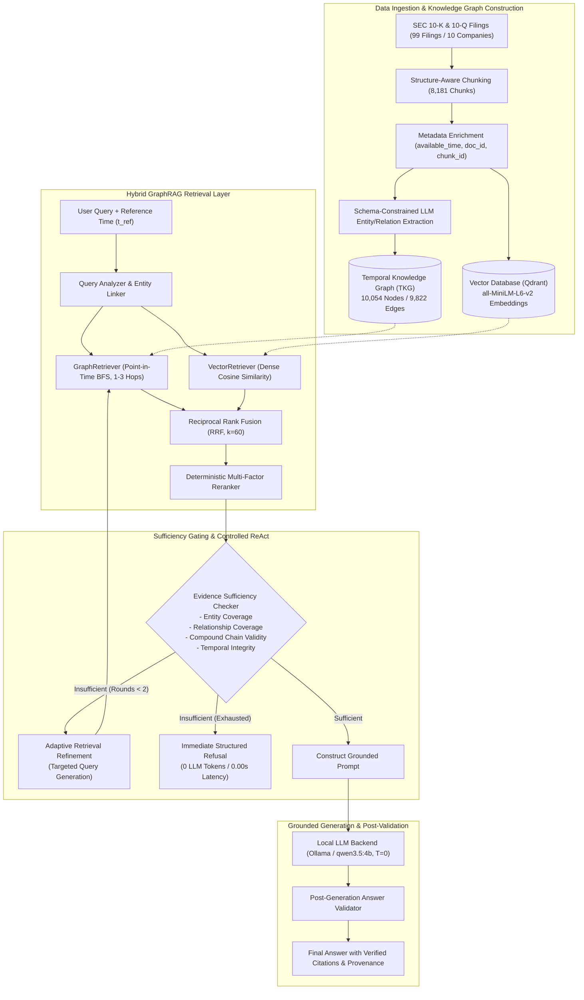
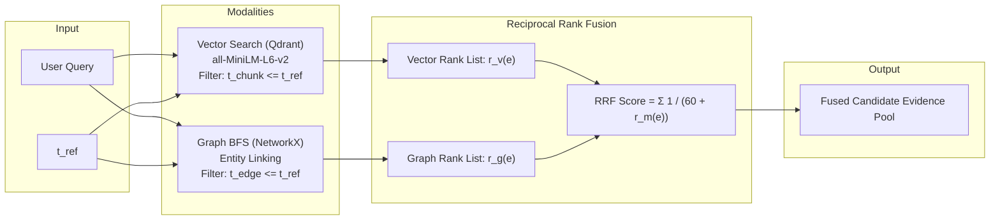
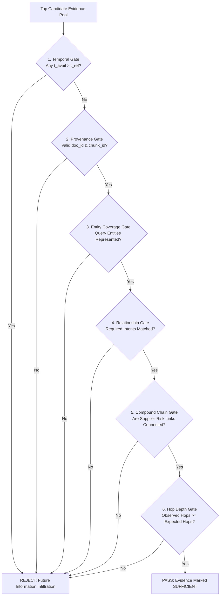
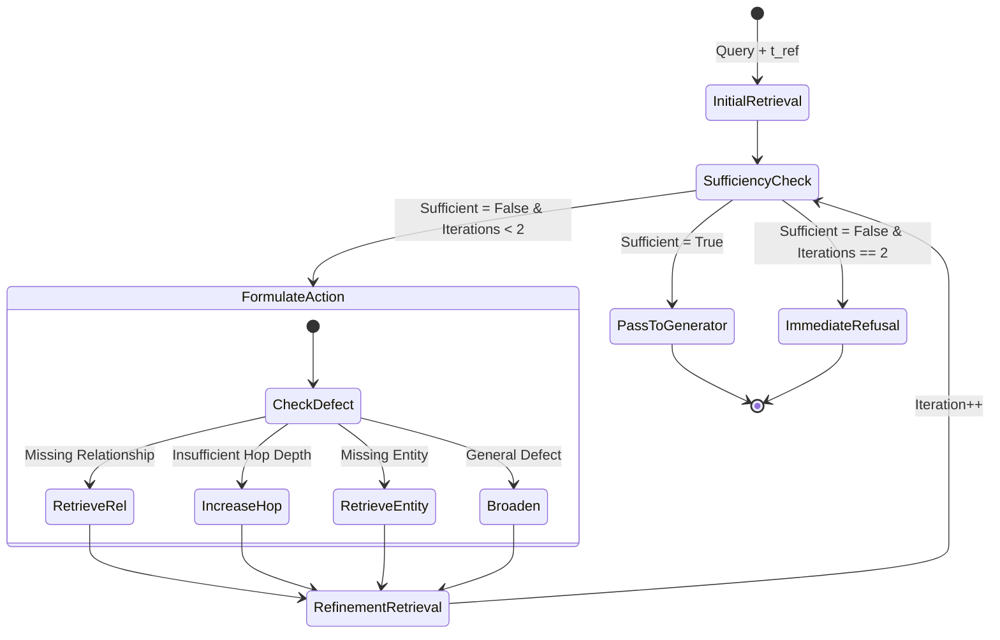

# FinGraph AI System Architecture

This document provides a comprehensive technical specification of the system architecture for **FinGraph AI: A Temporal Knowledge Graph and Hybrid GraphRAG Framework for Multi-Hop Financial Question Answering**.

---

## 1. System Overview & Core Design Principles

FinGraph AI combines financial NLP, a Temporal Knowledge Graph (TKG), hybrid vector-graph retrieval, deterministic reranking, an adaptive ReAct retrieval loop, a strict point-in-time evidence sufficiency gate, and an evidence-grounded answer generation layer.

### Core Architectural Principles
1. **Zero Temporal Leakage:** Financial information is time-stamped with public availability boundaries (`available_time`). All vector and graph retrieval components enforce hard temporal cutoffs ($t_{\text{avail}} \le t_{\text{ref}}$).
2. **Multi-Hop Relational Connectivity:** Complex queries requiring multiple relational steps (e.g., supplier risks or competitive dependencies) are resolved via directed graph traversal rather than keyword co-occurrence.
3. **Compound Evidence Chain Validation:** To avoid spurious reasoning (such as attributing a risk to Apple when an unrelated supplier experiences it), the sufficiency gate demands an unbroken, directionally valid evidence chain ($A \xrightarrow{\text{SUPPLIES}} B \land A \xrightarrow{\text{HAS\_RISK}} C$).
4. **Refusal Over Hallucination:** When the retrieved evidence does not satisfy entity, relationship, temporal, or chain constraints, the system issues an immediate structured refusal with zero LLM generation calls.
5. **Deterministic Provenance:** Every evidence item tracks its exact source filing (`document_id`), chunk (`chunk_id`), ingestion timestamp (`available_time`), and retrieval modalities.

---

## 2. End-to-End System Pipeline



---

## 3. Module Responsibilities & Source Map

| Subsystem | Primary Python Modules | Responsibilities |
| :--- | :--- | :--- |
| **Ingestion** | `src/ingestion/sec_extractor.py`<br/>`src/ingestion/chunker.py` | Parses SEC HTML filings, detects Item headers, produces structure-aware chunks, and attaches temporal metadata (`document_id`, `chunk_id`, `available_time`, `fiscal_period`). |
| **Graph Management** | `src/graph/models.py`<br/>`src/graph/storage.py`<br/>`src/graph/temporal_graph.py` | Defines node (`Company`, `Product`, `Supplier`, `Risk`) and edge (`SUPPLIES`, `AFFECTED_BY`, `HAS_RISK`, `COMPETES_WITH`) dataclasses; handles in-memory NetworkX indexing and JSON serialization. |
| **Vector Retrieval** | `src/retrieval/vector.py` | Encodes queries using `all-MiniLM-L6-v2`, executes dense cosine search against Qdrant, and filters chunks strictly by `available_time <= reference_time`. |
| **Graph Retrieval** | `src/retrieval/graph.py` | Links entities from query text to canonical graph nodes (`company:{TICKER}`), executes point-in-time BFS traversal up to 3 hops, prevents cycles, and verbalizes relational paths. |
| **Hybrid Fusion** | `src/retrieval/hybrid.py` | Combines vector and graph candidate lists using Reciprocal Rank Fusion ($k=60$), deduping identical chunk IDs and preserving original modality ranks. |
| **Reranking** | `src/retrieval/reranker.py` | Evaluates fused candidates using an explainable multi-factor scoring function and applies a hard $-\infty$ penalty to any candidate violating $t_{\text{avail}} \le t_{\text{ref}}$. |
| **Sufficiency Gate** | `src/qa/evidence_sufficiency.py` | Enforces pre-generation constraints on entity coverage, relationship presence, reasoning hop depth, provenance completeness, and **compound supplier-risk chain connectivity**. |
| **ReAct Loop** | `src/qa/agent.py` | Orchestrates a bounded retrieval loop (maximum 2 refinement iterations) formulating targeted actions (`retrieve_missing_relationship`, `increase_hop_depth`, `retrieve_missing_entity`). |
| **Answer Generation** | `src/qa/generator.py` | Builds strict evidence-only prompts, interfaces with local Ollama (`qwen3.5:4b`), and executes immediate refusal if evidence is insufficient or ungrounded. |
| **Answer Validation** | `src/qa/validator.py` | Parses JSON output, verifies citation existence against package evidence IDs, confirms zero post-cutoff references, and asserts confidence range $[0.0, 1.0]$. |
| **Evaluation Suite** | `src/evaluation/benchmark.py`<br/>`src/evaluation/temporal.py`<br/>`src/evaluation/leakage.py` | Computes retrieval metrics (Hit@K, MRR, NDCG@K, CrossDoc), QA metrics (EM, F1, Refusal Acc/Recall/Precision), temporal metrics (FEIR), and parametric leakage rate (PLR). |

---

## 4. Detailed Component Specifications

### 4.1 Hybrid Retrieval & Reciprocal Rank Fusion (RRF)

FinGraph AI merges two complementary retrieval modalities:
- **Vector Retrieval:** Identifies semantically relevant narrative passages from Item 1 (Business) and Item 1A (Risk Factors).
- **Graph Retrieval:** Navigates explicit multi-hop relational paths across the Temporal Knowledge Graph.



The fused score for each unique evidence item $e$ is computed as:
$$\text{RRF}(e) = \sum_{m \in \{\text{vector}, \text{graph}\}} \frac{\mathbb{I}(e \in R_m)}{k + \text{rank}_m(e)}$$
where $k = 60$ is the standard smoothing parameter, and $\text{rank}_m(e)$ is the 1-indexed rank of evidence item $e$ in modality $m$.

### 4.2 Deterministic Evidence Reranker

Fused candidates are rescored using a 5-factor deterministic formula:
$$\text{Score}(e) = \alpha \cdot \text{RRF}_{\text{norm}}(e) + \beta \cdot \text{Overlap}(e) + \gamma \cdot \text{RelMatch}(e) + \delta \cdot \text{Conf}(e) - \epsilon \cdot \text{hop\_penalty}(e)$$

- **Weights:** $\alpha = 0.20$, $\beta = 0.25$, $\gamma = 0.35$, $\delta = 0.15$, $\epsilon = 0.05$.
- **Hop Penalty:** $\text{hop\_penalty}(e) = \max(0, \text{hops}(e) - 1)$.
- **Zero Temporal Leakage Gate:**
  $$\text{If } t_{\text{avail}}(e) > t_{\text{ref}} \implies \text{Score}(e) = -\infty$$
  Any candidate with an availability timestamp following the query reference cutoff is instantly pruned.

---

### 4.3 Evidence Sufficiency Checker & Compound Chain Validation

The evidence sufficiency checker acts as a hard quality and safety gate prior to prompting the LLM. It verifies five core dimensions:



#### Compound Supplier-Risk Relationship Validation
For compound queries such as *"What manufacturing risks affect suppliers that supply Apple?"*, the query requires both a `SUPPLIES` relation and a `HAS_RISK` / `AFFECTED_BY` relation. The gate enforces that:
1. An intermediate supplier node $S$ exists such that $S \xrightarrow{\text{SUPPLIES}} \text{Apple}$.
2. The risk $R$ is directly attributed to that same supplier: $S \xrightarrow{\text{HAS\_RISK}} R$ or $S \xrightarrow{\text{AFFECTED\_BY}} R$.
3. Evidence consisting of $S_1 \xrightarrow{\text{SUPPLIES}} \text{Apple}$ and an unrelated company $S_2 \xrightarrow{\text{HAS\_RISK}} R$ is rejected as disconnected, preventing spurious risk attribution.

---

### 4.4 Controlled ReAct Retrieval Loop

If the initial retrieval round produces insufficient evidence, `RetrievalAgent` executes up to **2 refinement iterations**:



Refinement actions are strictly bounded:
- `retrieve_missing_relationship`: Directs graph traversal along the specific unobserved predicate.
- `increase_hop_depth`: Expands BFS traversal radius from $k$ to $k+1$ hops (max 3).
- `retrieve_missing_entity`: Executes targeted entity linking and dense search for unrepresented tickers.
- `broaden_retrieval`: Relaxes top-$k$ candidate threshold from 5 to 10.

---

### 4.5 Generative Answer Formulation & Post-Validation

When evidence passes the sufficiency gate, `AnswerGenerator` prompts the local LLM (`qwen3.5:4b` at temperature $0.0$). If evidence is marked insufficient, the system generates an immediate refusal:

```json
{
  "answer": "Insufficient evidence in the retrieved corpus.",
  "confidence": 0.0,
  "evidence_ids": [],
  "reasoning_summary": "Retrieved evidence does not satisfy query entity, relationship, or reasoning depth constraints."
}
```

When generation proceeds, the prompt requires strict JSON output. `AnswerValidator` verifies:
1. **JSON Well-Formedness:** Validates schema attributes (`answer`, `confidence`, `evidence_ids`, `reasoning_summary`).
2. **Citation Grounding:** Asserts that all cited `evidence_ids` belong to the retrieved package (`unknown_evidence_ids == 0`).
3. **Temporal Sanity:** Confirms that no cited evidence has `available_time > reference_time`.
4. **Confidence Bounds:** Ensures confidence score is within $[0.0, 1.0]$.
