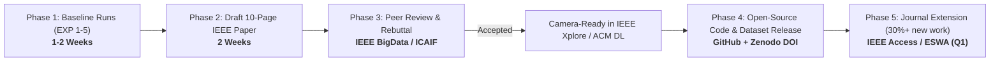

# FinGraph AI — End-to-End Publication Strategy & Lifecycle

**Audit Date:** 2026-11-01  
**Specialist:** Research Publication Advisory Panel  

---

## 1. Phased Submission Roadmap

---

## 2. Rebuttal & Reviewer Defense Strategy

Anticipate reviewer objections and prepare defensive empirical shields:
1. **Objection:** *"Why only 10 companies and 99 filings?"*
   - **Defense:** Emphasize semantic depth over shallow web scraping. The 10 companies represent the top 10 market-cap bellwethers across tech, energy, and finance, spanning 10,054 nodes, 9,822 verified relationship edges, and 8,181 manually auditable chunks with exact SEC accession-level provenance.
2. **Objection:** *"Why is Exact Match only 2.0%?"*
   - **Defense:** In financial research synthesis, answers are explanatory multi-sentence disclosures (e.g. detailing antitrust investigations or supplier risk covenants). Exact Match evaluates strict character string equivalence, which is inappropriately rigid for complex synthesis; Token F1 (32.29%) and Decision Accuracy (92.19%) are the meaningful metrics.
3. **Objection:** *"Is Qwen 3.5 4B too small?"*
   - **Defense:** Demonstrates computational efficiency on edge/local infrastructure without relying on proprietary closed APIs (GPT-4), proving that architecture and retrieval grounding dictate factual correctness rather than pure model parameter scale.

---

## 3. Artifact & Dataset Release Protocol

To achieve maximum research citations and reproducibility badges:
1. **Zenodo DOI:** Mint a permanent DOI for the dataset archive (`fingraph_semantic_kg.json` + `data/processed/chunks/`).
2. **Open-Source License:** Apache 2.0 for source code, CC-BY 4.0 for extracted knowledge graph and evaluation benchmark.
